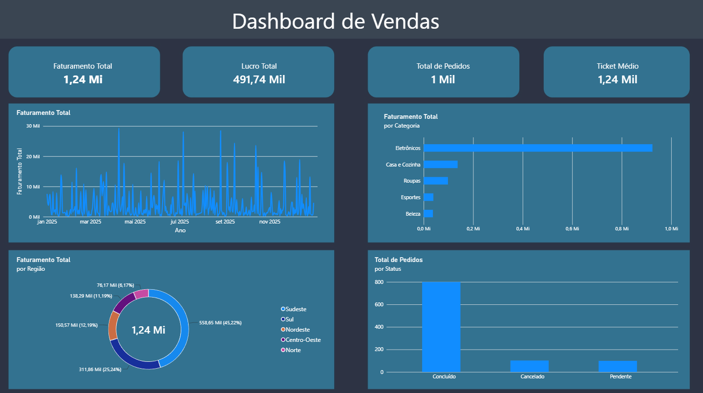

# 📊 Dashboard de Vendas e E-commerce (Power BI)

## 🎯 Sobre o Projeto
Este projeto consiste num **Dashboard de Vendas Interativo** desenvolvido no **Power BI Desktop**, criado com o objetivo de analisar o desempenho comercial, a lucratividade e o comportamento de um e-commerce. A solução foca-se em transformar dados brutos em insights visuais claros e estratégicos, utilizando uma interface moderna em **Dark Mode**.

---

## 🚀 Principais Funcionalidades e KPIs
O painel foi estruturado para responder a quatro grandes pilares de negócio através de KPIs dinâmicos:
* **Faturamento Total:** Receita gerada pelas vendas acumuladas no período.
* **Lucro Total:** Rentabilidade líquida após os custos.
* **Total de Pedidos:** Volume total de transações efetuadas.
* **Ticket Médio:** Valor médio gasto por pedido por cada cliente.

---

## 📈 Estrutura e Análises do Dashboard
O layout foi planejado em formato 16:9 com um design moderno em blocos flutuantes, contendo:
1. **Evolução Temporal (Gráfico de Linhas):** Acompanhamento diário e mensal do comportamento das vendas ao longo de 2025.
2. **Desempenho por Categoria (Gráfico de Barras):** Identificação das categorias de produtos com maior volume de faturamento (*Eletrônicos, Casa e Cozinha, Roupas, etc.*).
3. **Distribuição Geográfica (Gráfico de Rosca):** Participação percentual das vendas dividida por região (*Sudeste, Sul, Nordeste, Centro-Oeste e Norte*).
4. **Status dos Pedidos (Gráfico de Colunas):** Monitoramento do volume de pedidos concluídos, cancelados e pendentes.

---

## 🛠️ Tecnologias e Ferramentas Utilizadas
* **Power BI Desktop:** Modelagem de dados, criação de medidas DAX e construção visual.
* **Linguagem DAX:** Desenvolvimento de medidas personalizadas (*Faturamento Total, Lucro Total, Total de Pedidos e Ticket Médio*).
* **Power Query:** Limpeza, tratamento e tipagem correta dos dados da base original.
* **Canva / PowerPoint:** Criação personalizada do background/tela de fundo em *Dark Mode*.

---

